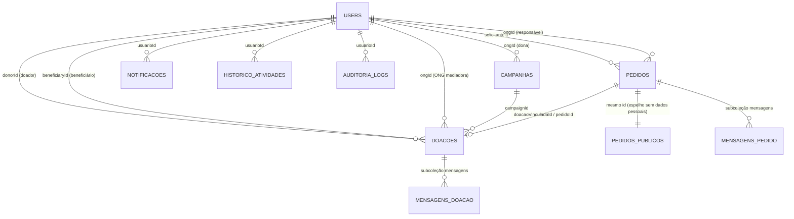

# Estrutura do banco de dados — Ponte Solidária

**Banco utilizado:** Cloud Firestore (Firebase), banco **NoSQL orientado a documentos**. Não há tabelas e linhas: os dados ficam em **coleções** de **documentos** (JSON). Os "relacionamentos" são feitos por **campos de referência** (o id de outro documento), e não por chave estrangeira imposta pelo banco — por isso a integridade é garantida pelas **Regras de Segurança** (`firestore.rules`) e pelo código. O login usa o **Firebase Authentication** (e-mail e senha); o `uid` de cada conta é o id do documento em `users`.

## Diagrama de relacionamentos

## Coleções

| Coleção | Conteúdo | Campos principais | Quem acessa |
|---|---|---|---|
| `users/{uid}` | Conta de cada usuário (equivale ao *users* sugerido pelo professor) | `name`, `role` (`person` \| `ong` \| `admin`), `phone`, `cpf`/`cnpj`, `address`, `status`, `approved`, `blocked`, `verified`, `cnpjVerificado`, `responsible_name`, `service_area`, `createdAt` | Cria: o próprio usuário, **só** com `role` person/ong e valores iniciais seguros. Muda `role/approved/blocked/status`: **somente admin**, em outra conta |
| `doacoes/{id}` | Doação cadastrada | `donorId`, `donorName`, `category`, `itemName`, `quantity`, `condition`, `validade`, `tamanho`, `city`, `deliveryMethod` (`direct` \| `ong`), `ongId`, `beneficiaryId`, `campaignId`, `pedidoId`, `progressStep`, `trackingStatus`, `history[]`, `createdAt` | Usuários logados leem; escrita só pelo papel certo em cada etapa |
| `doacoes/{id}/mensagens/{id}` | Chat da doação | `senderId`, `text`, `createdAt`, `deleted` | Só doador, beneficiário e ONG da doação |
| `pedidos/{id}` | Pedido de ajuda (completo, com nome da família) | `solicitanteId`, `solicitanteNome`, `solicitanteCidade`, `category`, `item`, `quantity`, `urgency`, `description`, `status`, `ongId`, `doacaoVinculadaId`, `history[]` | Só o solicitante, a ONG responsável e o admin |
| `pedidos_publicos/{id}` | **Espelho anonimizado** do pedido (sem nome nem fotos) | `solicitanteCidade`, `category`, `item`, `quantity`, `urgency`, `status` | Qualquer usuário logado |
| `pedidos/{id}/mensagens/{id}` | Chat do pedido | `senderId`, `text`, `createdAt` | Solicitante e ONG responsável |
| `campanhas/{id}` | Campanhas criadas pelas ONGs (*campaigns*) | `titulo`, `itensAceitos[]`, `categoria`, `localizacao`, `prazo`, `status`, `ongId`, `ongName` | Leitura: logados. Escrita: ONG aprovada dona / admin |
| `notificacoes/{id}` | Notificações de um usuário | `usuarioId`, `titulo`, `mensagem`, `tipo`, `lida`, `dataCriacao` | Só o dono |
| `historico_atividades/{id}` | Linha do tempo pessoal | `usuarioId`, `titulo`, `descricao`, `categoria`, `dataHora` | Só o dono |
| `auditoria_logs/{id}` | Auditoria (ações administrativas e eventos) | `usuarioId`, `acao`, `detalhes`, `dataHora`, `origem` | Leitura só admin; registros imutáveis |
| `estatisticas_publicas/{id}` | Totais agregados exibidos no site | `doacoesRecebidas`, `entregasConcluidas`, `ongsAprovadas`, `familiasAtendidas` | Leitura pública (sem dado pessoal) |

### Relacionamentos (resumo)
- **Usuário 1—N Doações** (como doador, beneficiário ou ONG mediadora).
- **Usuário 1—N Pedidos** (solicitante) e **ONG 1—N Pedidos** (responsável).
- **ONG 1—N Campanhas**; **Campanha 1—N Doações** (`campaignId`).
- **Pedido 1—0..1 Doação** (vínculo quando alguém atende o pedido).
- **Pedido 1—1 Pedido público** (mesmo id; o público não tem dados pessoais).
- **Doação / Pedido 1—N Mensagens** (subcoleção).
- **Usuário 1—N Notificações / Histórico / Auditoria**.

### Diferenças em relação ao modelo sugerido
O professor sugeriu `public_profiles` (dados públicos do perfil). Hoje, o perfil público é lido de `users`, e os dados pessoais da família foram separados em `pedidos` × `pedidos_publicos`. Evolução recomendada: criar `public_profiles/{uid}` (nome, cidade, tipo) e restringir a leitura de `users` ao próprio dono e ao admin.

## Segurança do banco
- Só existe conta `admin` criada manualmente no Console do Firebase; nenhum usuário consegue criar o próprio documento com `role: "admin"` (ver `docs/SEGURANCA-TESTE-ESCALADA.md`).
- Regras validam **quem** pode escrever e **quais campos** podem mudar em cada etapa do fluxo.
